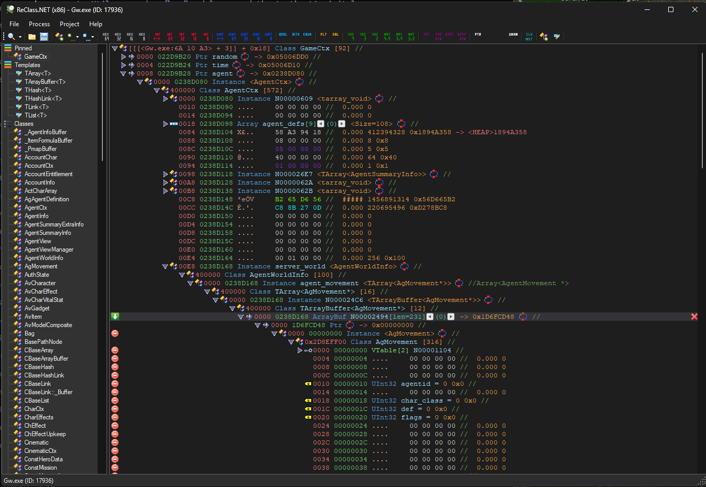

# ReClass.NET
This is a port of ReClass to the .NET platform with lots of additional features.



## KAOS Fork Major Changes

- Ported to .NET 10 runtime.
- Class field definition changes retain the shape of the parent class.
  - If adding a class instance for example, the class instance will absorb Base Hex Nodes to make room for the class instance instead of resizing the structure and shifting offsets of other nodes.
  - Deleting a field that is not a base hex node will likewise create base hex nodes to fill the memory left behind instead of removing bytes from the class.
- class template support.
  - New templates section. Define a template with template parameters used as placeholders e.x. `TArray<T>`
  - Within classes, define a Template Implementation field that combines the template along with chosen resolved parameters, no template parameters can be unresolved for a template implementation to be valid. e.g. `TArray<AgentView*>`
  - nested templates are supported e.g. `TArray<TList<T>> m_hashSlots;`
- Address formulas now support byte signature scanning
  - Module tokens e.g. <Gw.exe> now support a byte signature extension to scan for, such as <Gw.exe:55 8B EC 83 ??> etc.
- Added code generator for Rust.

**Transparency Statement:** Majority of work done in this fork was produced using Claude Fable 5.2.

## Features
- Support for x86 / x64
- File import from ReClass 2007-2016 and ReClass QT
- Memory Nodes
  - Arrays and Pointers to every other node types
  - Hex 8 / 16 / 32 / 64
  - Int 8 / 16 / 32 / 64
  - UInt 8 / 16 / 32 / 64
  - Bool
  - Bits
  - Enumerations
  - Float / Double
  - Vector 2 / 3 / 4
  - Matrix 3x3 / 3x4 / 4x4
  - UTF8 / UTF16 / UTF32 Text and pointer to text
  - Virtual Tables
  - Function
  - Function Pointer
  - Unions
- Automatic Node Dissection
- Highlight changed memory
- Pointer Preview
- Copy / Paste Support across ReClass.NET instances
- Display types from Debug Symbols (*.pdb)
- Display Runtime Type Informations (RTTI)
- Control the remote process: start / stop / kill
- Process Selection Dialog with filtering
- Memory Viewer
- Memory Scanner
  - Import files from Cheat Engine and CrySearch
  - Scan for values correlated to your input
- Class address calculator
- Code Generator (C++ / C# / Rust)
- Module / Section Dumper
- Debugger with "Find out what writes/accesses this address" support
- Plugin Support
  - Plugins can be written in different languages (example: C++, C++/CLI, C#)
  - Plugins can provide custom methods to access an other process (example: use a driver)
  - Plugins can interact with the ReClass.NET windows
  - Plugins can provide node infos which will be displayed (example: class informations for Frostbite games)
  - Plugins can implement custom nodes with load/save and code generation support

## Plugins
- [Sample Plugins](https://github.com/ReClassNET/ReClass.NET-SamplePlugin)
- [Frostbite Plugin](https://github.com/ReClassNET/ReClass.NET-FrostbitePlugin)
- [MemoryPipe Plugin](https://github.com/ReClassNET/ReClass.NET-MemoryPipePlugin)
- [LoadBinary Plugin](https://github.com/ReClassNET/ReClass.NET-LoadBinaryPlugin)
- [Handle Abuser Plugin](https://github.com/ReClassNET/ReClass.NET-HandleAbuser)
- Unreal Plugin (not available anymore) (by [DrP3pp3r](https://github.com/DrP3pp3r))
- [DriverReader](https://github.com/niemand-sec/ReClass.NET-DriverReader) (by [Niemand](https://github.com/niemand-sec))

To install a plugin just copy it in the "Plugins" folder.
Plugins written in C# must target `net10.0-windows` and reference `ReClass.NET.dll`. Plugins built for the .NET Framework versions of ReClass.NET need to be rebuilt.
If you want to develop your own plugin just learn from the code of the [Sample Plugins](https://github.com/ReClassNET/ReClass.NET-SamplePlugin) and [Frostbite Plugin](https://github.com/ReClassNET/ReClass.NET-FrostbitePlugin) repositories. If you have developed a nice plugin, leave me a message and I will add it to the list above.

## Installation

ReClass.NET runs on Windows and needs the [.NET 10 Desktop Runtime](https://dotnet.microsoft.com/download/dotnet/10.0). Install the x64 runtime for the launcher and the x64 version, and the x86 runtime as well if you want to use the x86 version.

## Tips
- Lots of elements have a context menu. Just right-click it and see what you can do there.
- The node window can be controlled with the keyboard too. Arrow keys can select other keys, combined with the shift key the nodes get selected. The menu key opens the context menu which itself can be controlled with the keyboard.
- The memory address field of a class can contain a real formula not just a fixed address.  
  
  **\<Program.exe> + 0x123** will use the base address of Program.exe and add 0x123 to it.  
  **[0x4012ABDE]** will read the integer (4 byte on x86 / 8 byte on x64) from the address 0x4012ABDE and use this value as class address.  
  **[\<Program.exe> + 0xDE] - AB** will use the base address of Program.exe, add 0xDE to it, read the value from this address and finally sub 0xAB from it.  
  **[\<Program.exe> + offset + [\<Program.exe> + offset2]]** Nested operations are supported too.  
  **[\<Program.exe:FF 35 ?? ?? ?? ?? E8> + 2]** will search the byte signature in Program.exe and use the address of the first match, so the formula survives updates of the program. **?** and **??** are wildcards for a whole byte, a single nibble can be a wildcard too (**F?**, **?5**). The result of the search is cached until the process gets re-attached or the module moves.  
  
  Valid operations are read ([..]), add (+), sub (-), mul (*) and div (/). Please note that all operations are integer calculations.

## Compiling
If you want to compile ReClass.NET just fork the repository and open the ReClass.NET.sln file with Visual Studio 2026. You need the ".NET desktop development" and "Desktop development with C++" workloads and the .NET 10 SDK.

The solution builds one application per platform (x86 / x64) plus the launcher:

```
msbuild ReClass.NET.sln -restore -p:Configuration=Release -p:Platform=x64
msbuild ReClass.NET.sln -restore -p:Configuration=Release -p:Platform=x86
```

The output is written to `bin\<Configuration>`. Use `msbuild` from a Visual Studio developer command prompt because `dotnet build` can't build the native core library.

To run the tests use `dotnet test ReClass.NET_Tests -p:Platform=x64` (or `x86`).

## Videos

[Youtube Playlist](https://www.youtube.com/playlist?list=PLO246BmtoITanq3ygMCL8_w0eov4D8hjk)

## Screenshots
Process Selection  


Memory Viewer  


Memory Scanner  


Pointer Preview  


Code Generator  


Plugins  


Settings  


## Authors / Special Thanks
- [KN4CK3R](https://github.com/KN4CK3R)
- DrUnKeN ChEeTaH
- P47R!CK
- DogMatt
- [ajkhoury](https://github.com/ajkhoury)
- [KAOS](https://github.com/GregLando113)
- [IChooseYou](https://github.com/IChooseYou)
- [stevemk14ebr](https://github.com/stevemk14ebr)
- [Timboy67678](https://github.com/Timboy67678)
- [DarthTon](https://github.com/DarthTon)
- [ReUnioN](https://github.com/ReUnioN)
- leveln
- [buddyfavors](https://github.com/buddyfavors)
- [DrP3pp3r](https://github.com/DrP3pp3r)
- [ko1N](https://github.com/ko1N)
- [Niemand](https://github.com/niemand-sec) (see his talk at [BlackHat Europe 2019 (London) "Unveiling the underground world of Anti-Cheats"](https://www.blackhat.com/eu-19/briefings/schedule/index.html#unveiling-the-underground-world-of-anti-cheats-17358))